# Архитектура HW10

Система тикетов, разделённая по CQRS: команды меняют состояние через агрегаты на event
sourcing, запросы читают отдельную read-модель, которую строит поток событий. Жизненным
циклом тикета управляет оркестратор с дедлайнами, а на события независимо реагируют
участники хореографии: скидки, уведомления, read-модель. Клиенты узнают об изменениях
через long polling.

С внешним миром система связана тремя паттернами взаимодействия контекстов: с CRM и ERP —
через Anti-Corruption Layer, с партнёрами — через Open-Host Service с опубликованным языком,
а правила статусов и SLA она делит с CRM в Shared Kernel.

Документ описывает устройство: абстрактное ядро, обе стороны CQRS, сагу и хореографию,
интеграции, полную схему команд и событий и протоколы. Как запустить и где что лежит — в
[README.md](README.md).

- [1. Крейты и зависимости](#1-крейты-и-зависимости)
- [2. Абстрактное ядро `framework`](#2-абстрактное-ядро-framework)
- [3. Командная сторона](#3-командная-сторона)
- [4. Запросная сторона](#4-запросная-сторона)
- [5. Оркестрация и хореография](#5-оркестрация-и-хореография)
- [6. Интеграции: Shared Kernel, ACL, Open-Host Service](#6-интеграции-shared-kernel-acl-open-host-service)
- [7. Полная схема команд и событий](#7-полная-схема-команд-и-событий)
- [8. Взаимодействие клиента и сервера](#8-взаимодействие-клиента-и-сервера)
- [9. Гарантии и ограничения](#9-гарантии-и-ограничения)

## 1. Крейты и зависимости

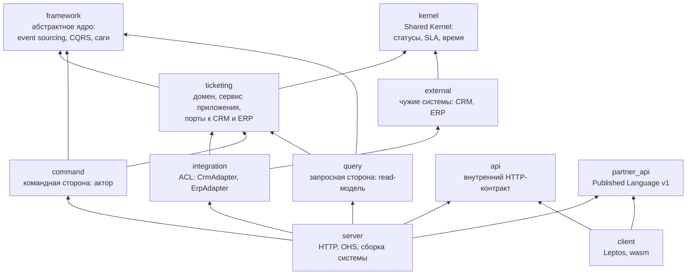

- `framework` не знает о тикетах и не зависит ни от чего (tokio — только в тестах).
- `kernel` не зависит ни от чего. От него зависят и система тикетов, и CRM — в этом смысл
  Shared Kernel.
- `ticketing` не знает ни `external`, ни `integration`: к CRM и ERP он обращается через свои
  порты, а реализуют их адаптеры ACL. Связывает их только `server`.
- `command` и `query` не зависят друг от друга: общий у них только тип события
  `ticketing::domain::DomainEvent` и конверт `framework::cqrs::envelope::Envelope`.
- Клиент знает только контракты `api` и `partner_api` — ни домена, ни ядра. Портал партнёра
  в клиенте говорит только на `partner_api`, как настоящий партнёр.

## 2. Абстрактное ядро `framework`

Четыре модуля: `event_sourcing` — как агрегат принимает решения и восстанавливается из
событий, `cqrs` — как разделены запись и чтение и как их связывает поток событий,
`saga` — долгоживущие процессы с дедлайнами, `in_memory` — реализации хранилищ event
sourcing. CQRS не требует event sourcing,
поэтому это отдельные модули; в проекте они встречаются в `TicketService`.

### 2.1. `event_sourcing`

Агрегат описывается двумя чистыми функциями без ввода-вывода:

| Трейт | Что задаёт |
|---|---|
| `Aggregate` | Словарь агрегата: типы `Command` и `Event`. |
| `CommandHandler` | `decide(&self, &Command) -> Result<Event, Error>` — решение: событие или отказ. Состояние не меняет. Всё нужное для решения (время, идентификаторы, данные других агрегатов) приходит в самой команде. |
| `EventHandler` | `apply_event(self, &Event) -> Self` — следующее состояние. Событие — уже свершившийся факт, отклонить его нельзя; невозможное событие означает испорченный стрим (паника). |
| `EventSourced` | Реализуется автоматически: `recover(stream)` — свёртка событий в состояние. |
| `Lifecycle` | Частый случай — агрегат, которого до первого события нет. Домен описывает `decide_new` (агрегата ещё нет), `decide`, `created` (первое событие) и `evolve`; каркас сам реализует три трейта выше для `Option<T>`, где `None` — пустой стрим. |

Хранение и связка:

| Тип | Что делает |
|---|---|
| `StreamId`, `EventPos` | Стрим — свой у каждого экземпляра агрегата. Позиция — граница *после* события: `EventPos(n)` — состояние после первых `n` событий, поэтому снапшот на позиции `n` и чтение стрима с `n` стыкуются без ±1. |
| `EventStore<E>` | Append-only стримы: `event_stream_from_pos`, `store_event`. Методы асинхронные, future — `Send`. |
| `SnapshotStore<A>` | Снапшоты: `save_snapshot(id, pos, state)`, `load_latest_snapshot`. Снапшот только ускоряет восстановление. |
| `Repository<A, ES, SS>` | `load` — последний снапшот плюс события после него; `execute` — load → decide → store → снапшот, если длина стрима кратна `snapshot_every`. Ошибки — `RepositoryError::{Domain, Storage}`. |

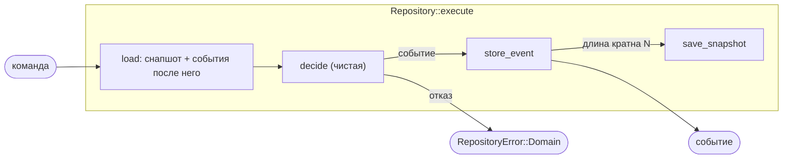

### 2.2. `cqrs`

| Тип / трейт | Роль |
|---|---|
| `Version` | Глобальная версия — номер события в общем порядке записи всех стримов. Как и `EventPos`, граница после события: `Version(0)` — ничего нет, первое событие — `Version(1)`. |
| `Envelope<E>` | Событие с его глобальной версией. |
| `Committed<E>` | Результат команды: версия после неё и записанные события. Версия — consistency token: read-модель, дошедшая до неё, видит результат команды. |
| `CommandBus<C>` | Входная точка записи: `send(command) -> Committed`. В отличие от `CommandHandler` агрегата, работает на уровне приложения: находит агрегат, подставляет время, упорядочивает команды. |
| `EventSource<E>`, `Subscription<E>` | Поток событий для читающей стороны: `subscribe(after)` отдаёт сначала уже записанные события с версией больше `after`, затем новые — без пропусков и повторов. |
| `Projection<E>` | Read-модель из потока: `project(&Envelope)` и `version()` — до какой версии догнала поток. Методы принимают `&self`: модель одновременно обновляют и читают. |
| `Query`, `QueryHandler<Q>` | Запрос — структура с параметрами и типом ответа `Output`; обработчик отвечает по read-модели и ничего не меняет. Симметрично командам. |
| `Policy<E>` | Process manager: чистая функция «событие → команды». Решает агрегат, поэтому отклонённая команда политики — нормальный исход. |

Фоновые циклы `cqrs::runner` написаны только на трейтах:

- `run_projection(source, projection)` — подписывается с `projection.version()` и
  применяет события. Ошибка проекции останавливает цикл: продолжать с дырой в модели нельзя.
- `run_policy(source, after, policy, bus, on_error)` — на каждое событие отправляет
  предложенные политикой команды по одной и по порядку; отказы уходят в `on_error`.

### 2.3. `saga`

Сага описывает один экземпляр процесса как автомат без ввода-вывода: на вход событие или
сработавший дедлайн, на выход эффекты. Время, очередь и отправку команд берёт на себя
окружение, поэтому логику процесса можно проверить без таймеров.

| Тип | Что делает |
|---|---|
| `Saga` | `id_of(event)` — к какому экземпляру относится событие; `start(event)` — запускает ли оно процесс; `on_event`, `on_deadline` — реакции. Тип времени задаёт сама сага: ядро требует только упорядоченности. |
| `Effects<C, D, T>` | Что сделать: `command`, `schedule(name, at)`, `finish`. Чистое значение, а не вызовы. |
| `DeadlineQueue<K, D, T>` | Дедлайны по экземплярам: `BTreeSet` по времени и `BTreeMap` по ключу. Дедлайн с тем же именем заменяет прежний, `cancel_all` снимает все дедлайны экземпляра сразу, а не ждёт их срока. |
| `SagaManager<S>` | Экземпляры и очередь: `on_event`, `fire_next(&now)`, `next_deadline`. `fire_next` срабатывает по одному дедлайну за раз, чтобы между ними можно было разобрать новые события. |

Саги не хранят себя отдельно: всё их состояние выводится из журнала, поэтому менеджер
восстанавливается подпиской на события с начала. Ответы на отправленные команды в автомат не
возвращаются: об исходе сообщает следующее событие.

### 2.4. `in_memory`

`InMemoryEventStore` (вектор событий на стрим) и `InMemorySnapshotStore` (только последний
снапшот стрима). Методы асинхронные лишь потому, что так требуют трейты: внутри нет `await`.

### 2.5. Кто что реализует

| Абстракция | Реализация |
|---|---|
| `Lifecycle` | `Ticket`, `Tenant`, `User` (`ticketing::domain`) |
| `Repository` над `in_memory` | три репозитория в `TicketService` (снапшот каждые 2 события) |
| `CommandBus<C: Into<Command>>`, `EventSource<DomainEvent>` | `command::CommandActorHandle` |
| `Subscription<DomainEvent>` | `command::EventSubscription` (обёртка над каналом tokio — правило сирот не даёт реализовать трейт для чужого типа напрямую) |
| `Projection<DomainEvent>`, `QueryHandler<…>` для 11 запросов | `query::ReadModel` |
| `Policy<DomainEvent>` | `ticketing::application::discount_policy::DiscountPolicy`, `ticketing::application::notifications::NotificationPolicy`, `ticketing::application::customer_notices::CustomerNoticePolicy` |
| `Saga` | `ticketing::application::ticket_lifecycle::TicketLifecycleSaga` |
| `CustomerDirectory`, `CustomerNotifier` | `integration::crm::CrmAdapter` |
| `Inventory` | `integration::erp::ErpAdapter` |
| `Notifier` | `server::notifier::LogNotifier` |

## 3. Командная сторона

### 3.1. `TicketService`

Сервис приложения (`ticketing::application`). Принимает внешние команды (`CreateTicketCommand`,
`CloseTicketCommand`, …), достраивает их до команд агрегатов — выдаёт идентификаторы,
берёт время из `Clock`, подставляет данные других агрегатов — и выполняет через репозитории.

- **`OpenTickets`** — собственная синхронная проекция командной стороны: счётчик открытых
  тикетов на тенанта, ответ за O(1). Она согласована с записью (обновляется в той же
  операции), поэтому скидку считают по ней, а не по read-модели, которая может отставать.
- **`Clock`** — источник времени: `SystemClock` в работе, `ManualClock` в тестах, `ScaledClock`
  для демонстрации сроков (`--time-scale`). Домен и сага разницы не видят.
- **Outbox.** Каждое записанное событие сразу попадает в outbox, `take_outbox()` их
  забирает. События не теряются, даже если команда записала часть событий и вернула ошибку.

### 3.2. Актор (`command`)

`command::spawn(service)` запускает задачу tokio, которая единолично владеет
`TicketService`, и возвращает `CommandActorHandle`.

- **Один писатель.** Команды из очереди (ёмкость 64) выполняются строго по одной:
  между проверкой и записью ничего не вклинивается, у событий однозначный порядок,
  блокировок нет.
- **Журнал и версии.** После каждой команды актор забирает outbox, присваивает событиям
  следующие глобальные версии, дописывает их в журнал (общий поток всех стримов)
  и рассылает подписчикам. Отклонённая команда версию не занимает.
- **Подписка** с любой версии: история из журнала, затем новые события. Проекция, политики
  и сага могут стартовать в любой момент — даже после seed.

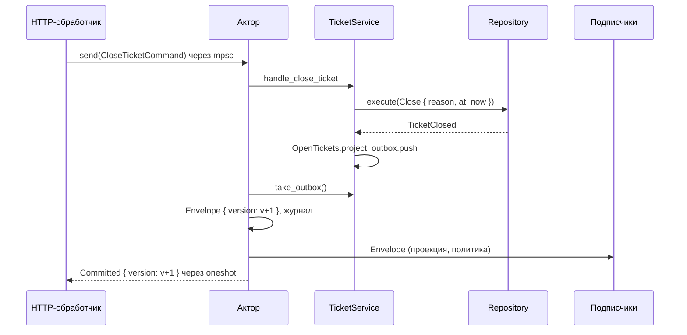

## 4. Запросная сторона

`query::ReadModel` — клонируемая оболочка над состоянием в `RwLock` и `watch` с версией.

### 4.1. Модели представления

| View | Поля |
|---|---|
| `TicketView` | `ticket_id, category, description, status, assigned_agent, tenant_id, created_at, closed_at, close_reason, last_activity, reminders_sent, tier, sla, sla_met, resources, partner (партнёр и время передачи), partner_updates, version`; `closes_at()` вычисляется из `last_activity` и поэтому не может с ней разойтись |
| `TenantView` | `tenant_id, tenant_name, discount_rate, open_tickets, version` |
| `UserView` | `user_id, user_name, role, version` |
| `NotificationView` | `notification_id, recipient, ticket_id, kind, at, version` |
| `Changes` | `version` модели и изменённые записи каждого вида |

`version` записи — версия её последнего изменения. У закрытого тикета остаётся агент,
который им занимался.

### 4.2. Индексы под запросы

| Индекс | Запрос |
|---|---|
| `active_by_agent: UserId → {TicketId}` — незакрытые тикеты агента | `ActiveTicketsOfAgent` |
| `by_tenant: TenantId → {TicketId}` | `ListTickets { tenant_id }`, `UnassignedTicketsOfTenant` |
| `by_partner: PartnerId → {TicketId}` — тикеты, переданные партнёру; при повторном открытии тикет уходит из индекса | `TicketsOfPartner` (для Open-Host Service) |
| `closed: {(closed_at, TicketId)}` — упорядочен по времени | `TicketsClosedSince(t)` — диапазон `t..` |
| `inbox: Recipient → [номер уведомления]` | `NotificationsOf(user)`: агенту — его личные, администратору — общие, остальным — ничего |
| `changed: {(Version, запись)}` — каждая запись один раз, под последней версией | `ChangesSince(v)` — диапазон `v+1..` |

Запросы: `GetTicket`, `ListTickets { status, tenant_id }`, `ActiveTicketsOfAgent`,
`UnassignedTicketsOfTenant`, `TicketsClosedSince`, `TicketsOfPartner`, `GetTenant`, `ListTenants`,
`ListUsers`, `NotificationsOf`, `ChangesSince`. Read-модель не знает текущего времени: «за последние N дней» превращает
в момент `since` сервер.

### 4.3. Применение событий

- Событие с версией не выше текущей пропускается — повторная доставка безопасна.
- Пропуск версии — ошибка `Gap`, ссылка на неизвестную запись — `UnknownTicket` /
  `UnknownTenant`. Каждый обработчик сначала находит все нужные записи и только потом
  меняет их, так что ошибка не оставляет модель наполовину обновлённой.
- Уведомления read-модель строит той же чистой `NotificationPolicy`, что и доставка: правила
  «кого о чём уведомить» записаны в одном месте и разойтись не могут.
- Блокировка берётся только на время синхронного обновления или чтения и никогда не
  держится через `await`. Ждущих (`wait_until(version)`) модель будит, только когда
  изменения уже видны читателям.

## 5. Оркестрация и хореография

`server::app` запускает рядом с актором шесть задач tokio. Они не знают друг о друге:
единственная связь между ними — журнал событий. Две последние ходят во внешние системы —
они описаны в [разделе 6](#6-интеграции-shared-kernel-acl-open-host-service).

| Задача | Стиль | Что делает |
|---|---|---|
| `run_ticket_lifecycle(актор, часы, тик)` | оркестрация | Ведёт каждый открытый тикет к закрытию: держит дедлайны, отправляет `SendReminder` и `CloseTicket`. Устаревшие дедлайны — норма, остальные отказы пишутся в stderr. |
| `run_policy(актор, v0, DiscountPolicy, актор)` | хореография | На события, меняющие число открытых тикетов, отправляет `ApplyDiscount`. `DiscountUnchanged` — норма, остальные отказы пишутся в stderr. |
| `run_notifications(актор, v0, LogNotifier)` | хореография | Превращает события в уведомления и передаёт их порту `Notifier`. |
| `run_projection(актор, ReadModel)` | хореография | Держит read-модель в актуальном состоянии. |
| `run_resource_planning(актор, v0, ErpAdapter, партнёры, актор)` | хореография | На новый или открытый заново тикет спрашивает ERP, записывает ответ и, если ресурсов нет, передаёт тикет партнёру. |
| `run_customer_notices(актор, v0, CrmAdapter)` | хореография | Сообщает клиенту через CRM о принятии, закрытии и повторном открытии тикета. |

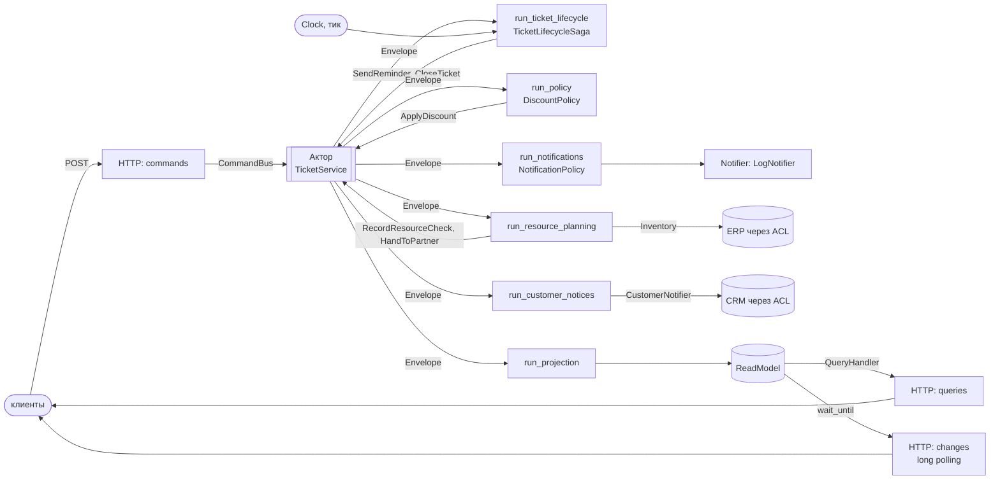

### 5.1. Оркестратор: `TicketLifecycleSaga`

Один экземпляр на тикет. Сроки считаются от последней активности: создания, назначения
агента, повторного открытия или отчёта партнёра. Напоминание, проверка ресурсов и передача
партнёру активностью не считаются: их делает система, а не люди.

| День | Дедлайн | Команда | Результат |
|---|---|---|---|
| 3 | `Reminder(Stale)` | `SendReminder` | `ReminderSent` агенту, а если агента нет — администраторам |
| 9 | `Reminder(ClosingSoon)` | `SendReminder` | то же |
| 10 | `AutoClose` | `CloseTicket { Inactivity }` | `TicketClosed` |

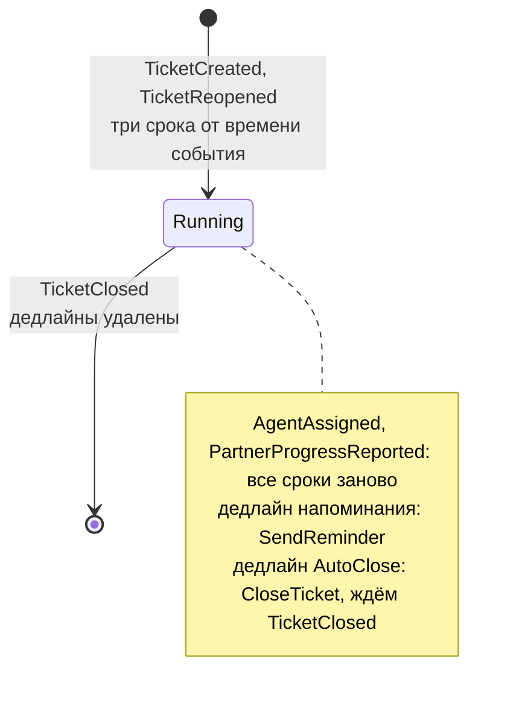

**Решает агрегат, а не сага.** Команда могла устареть, пока шла к актору, поэтому агрегат
проверяет срок сам: `StillActive`, `ReminderNotDue`, `ReminderAlreadySent`, `Closed`. Для саги
такой отказ — обычный исход: о том, что произошло на самом деле, сообщит событие, которое
команду опередило. Поэтому и команда автозакрытия не завершает процесс: сага дожидается
`TicketClosed`.

**Цикл `run_ticket_lifecycle`.** Сага работает в одной задаче: `select!` с приоритетом событий
над тиком. На каждом тике цикл по очереди разбирает все накопившиеся события и запускает один
созревший дедлайн, затем ждёт ответ на его команду и повторяет. Отсюда три свойства:

- Отменённые дедлайны снимаются сразу, а не ждут своего срока, и очередь не копит мусор.
- Много дедлайнов, созревших одновременно, занимают в очереди актора по одному месту. HTTP-команды
  не ждут, пока пройдёт вся пачка.
- Событие, пришедшее между двумя созревшими дедлайнами, успевает отменить второй из них.
  Остаётся узкая гонка с командой, которая уже в пути: её отклонит агрегат.

**Почему очередь, а не иерархическое колесо времени.** Разовый замер (код замера в репозиторий
не входит) показал, что колесо быстрее `DeadlineQueue` в 5–10 раз на отдельных операциях, но
предел системы — актор, около 7,3 мкс на команду. Настоящим узким местом оказался подсчёт
открытых тикетов перебором: на 300 тысячах тикетов он занимал 328 мкс, со счётчиком — 6,9 мкс.
API очереди узкий, поэтому заменить её позже можно, не трогая сагу.

### 5.2. Хореография

Участники реагируют на факты сами, и никто ими не управляет. Новый участник не требует
изменений ни в саге, ни в других участниках: `NotificationPolicy` добавлена, не затронув
`DiscountPolicy`, а сага не знает, что её напоминания кто-то доставляет.

| Событие | `NotificationPolicy` → получатель |
|---|---|
| `TicketCreated` | `NewTicket` → администраторы |
| `TicketReopened` | `Reopened` → администраторы |
| `AgentAssigned` | `Assigned` → новый агент; `Unassigned` → прежний, если он был |
| `ReminderSent` | `Reminder(kind)` → агент или, если его нет, администраторы |
| `TicketClosed` | `Closed(reason)` → агент; без агента при `Inactivity` → администраторы, при `Resolved` → никто |
| `ResourcesChecked`, `HandedToPartner`, `PartnerProgressReported` | — шаги интеграции, сотрудников о них уведомлять не нужно: они видны на карточке тикета |

Доставка — порт `Notifier`: политика решает, кого уведомить, `run_notifications` передаёт
уведомления порту, а сервер подключает `LogNotifier`, который пишет их в stdout. Настоящий канал
(почта, мессенджер) — другая реализация того же трейта.

### 5.3. Пример: тикет без активности

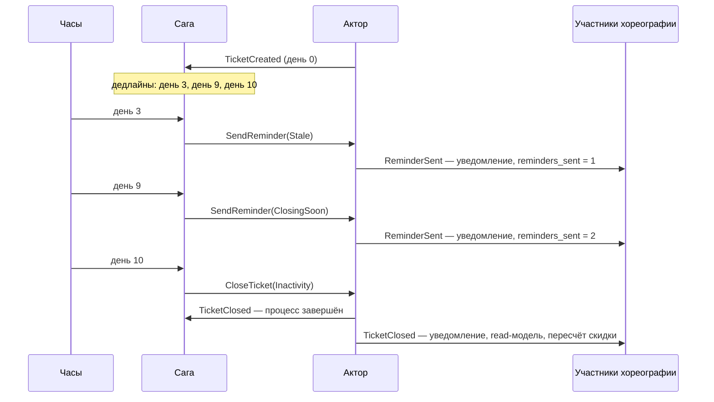

## 6. Интеграции: Shared Kernel, ACL, Open-Host Service

Бизнес-процесс задания проходит через три внешние стороны:

1. тикет создаётся, если CRM знает клиента и его договор действует;
2. ERP отвечает, хватает ли своих ресурсов (запчастей на складе);
3. если не хватает — тикет передаётся партнёру, и тот отчитывается о работе;
4. о результате клиенту сообщает CRM.

С каждой стороной выбран свой способ взаимодействия контекстов:

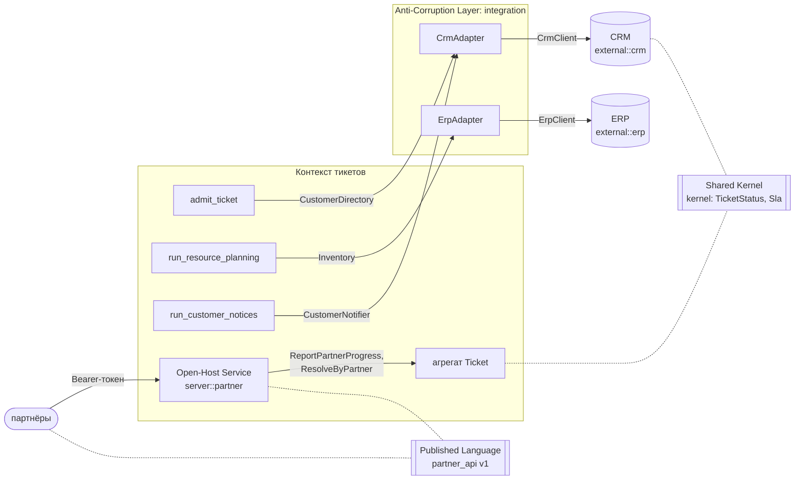

| Сторона | Паттерн | Почему |
|---|---|---|
| CRM: правила | Shared Kernel | Статусы и SLA — договорённость двух команд: правила одни, меняют их вместе. |
| CRM: протокол | Anti-Corruption Layer | Формат CRM чужой и устаревший: коды, номера счетов, миллисекунды. Его не пускают в домен. |
| ERP | Anti-Corruption Layer | Чужая модель SAP-подобного склада: заводы, группы материалов, остатки и резервы. |
| Партнёры | Open-Host Service + Published Language | Партнёров много, и каждому подстраиваться под нас дешевле, чем нам под каждого: один открытый версионированный протокол для всех. |

### 6.1. Shared Kernel: `kernel`

Крейт без зависимостей, от которого зависят и `ticketing`, и CRM (`external::crm`).

| Тип | Правило |
|---|---|
| `TicketStatus` | `can_become(next)` разрешает ровно пять переходов: `Open → InProgress` (назначили агента), `InProgress → InProgress` (переназначили), `Open \| InProgress → Closed`, `Closed → Open`. `transition_to` возвращает новый статус или `InvalidTransition { from, to }`. |
| `CustomerTier` | Gold, Silver, Bronze; `resolution_secs` — 1, 3 и 5 дней. |
| `Sla` | Начало и отведённое время. `due_at()` — срок; `is_overdue(at)` — нарушено ли к моменту `at` (решение ровно в срок укладывается); `remaining_secs(at)`. Время передаётся снаружи: SLA одинаково считают агрегат, read-модель и CRM, его можно проверить тестами, и оно не ломается при `--time-scale`. |
| `Timestamp`, `DAY_SECS` | Время в секундах, без переполнения при сложении. |

Как ядро используют стороны:

- **Агрегат `Ticket`** проверяет назначение, закрытие и повторное открытие через
  `ensure_can_become`, который спрашивает `TicketStatus::transition_to`. Запрет он переводит
  в свои ошибки `Closed` или `AlreadyOpen`: правило общее, а сообщение — на языке тикетов.
  SLA агрегат считает сам: `Sla::for_tier(tier, at)` при создании и повторном открытии,
  `!sla.is_overdue(at)` — в поле `sla_met` события `TicketClosed`.
- **CRM** ведёт историю обращений клиента. Код состояния из запроса она переводит в
  `TicketStatus` и проверяет `can_become`. Новое обращение начинается с `NEW`, после
  `RESOLVED` повторное закрытие отвергается — так же, как в агрегате.

`ticketing` реэкспортирует `kernel::time`, `kernel::sla` и `TicketStatus`, поэтому `command`,
`query` и `server` пользуются ими как частью домена.

### 6.2. Anti-Corruption Layer: порты и адаптеры

Порты (`ticketing::application::ports`) описаны на языке тикетов:

| Порт | Что спрашивает | Реализация |
|---|---|---|
| `CustomerDirectory::find_customer(tenant_id)` | `Option<CustomerProfile { name, email, tier, active }>` | `CrmAdapter` |
| `CustomerNotifier::notify_customer(&CustomerNotice)` | `Received { due_at }`, `Closed { reason, sla_met }`, `Reopened { due_at }` | `CrmAdapter` |
| `Inventory::check_resources(category)` | `ResourceAvailability::{Available, Unavailable}` | `ErpAdapter` |

Сбой любой внешней системы — `ExternalError`, тоже без её терминов: `Unavailable` (не ответила,
можно повторить) или `Rejected` (ответ нельзя перевести или запрос отвергнут).

Чужие модели (`external`) и их перевод (`integration`):

| Модель тикетов | CRM | Перевод |
|---|---|---|
| `TenantId(42)` | `acct_no: "ACC-000042"` | `account_number` |
| `TicketId(7)` | `case_ref: "TKT-7"` | `case_reference` |
| `CustomerTier` | `svc_lvl_cd: "GLD" \| "SLV" \| "BRZ"`; пусто — по умолчанию | `tier_from_code`: без учёта регистра, пустой код — Bronze, неизвестный (`PLT`) — `Rejected`, а не догадка |
| `active: bool` | `acct_stat_cd: "A" \| "S" \| "C"` | `A` — активен, `S` и `C` — нет, остальное — `Rejected` |
| `email: Option<String>` | `email_addr`, пустая строка — нет адреса | пустой → `None` |
| `CustomerNoticeKind` | `case_stat: NEW, RESOLVED, AUTO_CLOSED, REOPENED`, `sla_met_flag: Y \| N \| ""`, `due_ts_ms` (0 — нет) | `to_case_activity`; секунды → миллисекунды без переполнения |
| `ExternalError` | `CrmFault::{ServiceDown, NoSuchAccount, UnknownCaseStatus, InvalidCaseTransition}` | `ServiceDown` → `Unavailable`; `NoSuchAccount` при поиске → «клиента нет», остальное → `Rejected` |

| Модель тикетов | ERP | Перевод |
|---|---|---|
| категория тикета | `ErpStockRequest { werks: "1000", matkl }` | `material_group`: `Hardware` → `MG-HW`, `Network` → `MG-NET`; для остальных ERP не спрашивают — ресурсы есть |
| `ResourceAvailability` | `ErpStockLevel { labst, resb, meins }` | `availability`: `labst − resb > 0`; склад в минусе — ресурсов нет |
| `ExternalError` | `ErpFault::{Timeout, UnknownPlant, UnknownMaterialGroup}` | `Timeout` → `Unavailable`, остальное → `Rejected` |

Адаптеры обобщены по клиенту внешней системы (`CrmAdapter<C: CrmClient>`), поэтому в тестах
их можно проверить и на `InMemoryCrm`, и на заглушке, которая отдаёт любые чужие записи.

### 6.3. Процесс: приём, ресурсы, партнёр, сообщения клиенту

**Приём тикета.** Актор выполняет команды по одной и не должен ждать внешних систем, поэтому
CRM спрашивают до него: `admit_ticket` получает профиль клиента и достраивает
`CreateTicketCommand` его уровнем. Неизвестный клиент — 404, неактивный — 409, CRM недоступна —
503, CRM ответила непереводимо — 502.

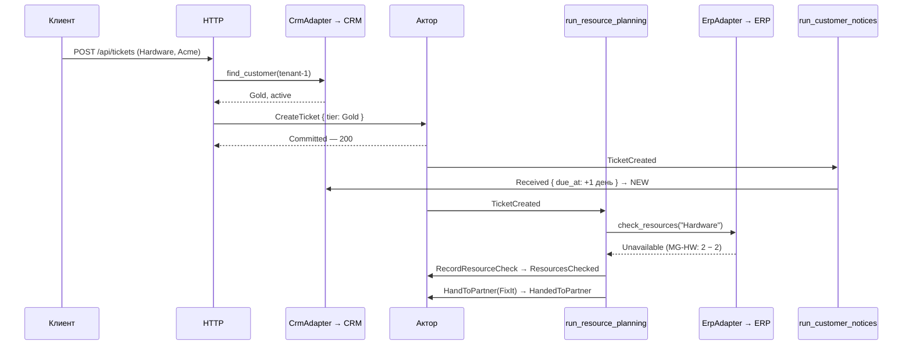

**Планирование ресурсов** (`run_resource_planning`) реагирует на `TicketCreated` и
`TicketReopened`; категория есть в обоих событиях. Решения принимает агрегат:

- `RecordResourceCheck` — один раз за заход, только для открытого тикета;
- `HandToPartner` — только если ERP ответила `Unavailable`, и только одному партнёру.

Партнёра выбирает `PartnerRoster` по категории. Сбой ERP, отсутствие подходящего партнёра или
отказ агрегата уходят в `on_error`, цикл идёт дальше. Отказ `Closed` — норма: тикет закрыли,
пока ERP думала.

**Сообщения клиенту** (`run_customer_notices`) строит чистая `CustomerNoticePolicy`:
`TicketCreated` → `Received`, `TicketClosed` → `Closed` с `sla_met`, `TicketReopened` →
`Reopened`. Назначения, напоминания и работа с партнёрами — внутренняя кухня, о ней клиенту
не пишут.

### 6.4. Open-Host Service для партнёров

Опубликованный язык — крейт `partner_api`, отдельный от внутреннего `api`: внутренний меняется
вместе с нашим клиентом, а партнёрский — только новой версией (`/partner/v2`).

| Метод и путь | Ответ |
|---|---|
| `GET /partner/v1/tickets` | `[PartnerTicket]` — тикеты, переданные партнёру, открытые и закрытые |
| `GET /partner/v1/tickets/{id}` | `PartnerTicket` или 404 |
| `POST /partner/v1/tickets/{id}/updates` с `{"status": "in_progress" \| "resolved", "comment": "..."}` | обновлённый `PartnerTicket` |

- **`PartnerTicket`** — то, что нужно партнёру: категория, описание, имя клиента, статус
  (`open`, `resolved`, `closed_for_inactivity`), время передачи, срок по SLA, время закрытия
  и отчёты. Агенты, напоминания и ответы ERP в контракт не входят.
- **Аутентификация.** `Authorization: Bearer <токен>` → `PartnerId` (экстрактор `PartnerAuth`).
  Без токена или с неизвестным — 401 с `WWW-Authenticate: Bearer`.
- **Изоляция.** Тикет другого партнёра или открытый заново для партнёра не существует — 404.
  Сначала это проверяет read-модель (индекс `by_partner`), а в гонке — агрегат (`NotWithPartner`).
- **Отчёты — команды агрегата.** `in_progress` даёт `ReportPartnerProgress`: нужен непустой
  комментарий, и это активность — сага и read-модель сдвигают сроки. `resolved` даёт
  `ResolveByPartner` — тот же `TicketClosed(Resolved)`, что при закрытии агентом, но проходит
  только от партнёра этого тикета. Комментарий к `resolved` сначала записывается отдельным
  отчётом.
- **Ошибки** — `PartnerError { code, message }`: `unauthorized` 401, `not_found` 404,
  `closed` 409, `invalid` 422, `unavailable` 503.
- **Read-your-writes.** Ответ на `POST` приходит, когда read-модель дошла до версии команды:
  следующий `GET` увидит отчёт.

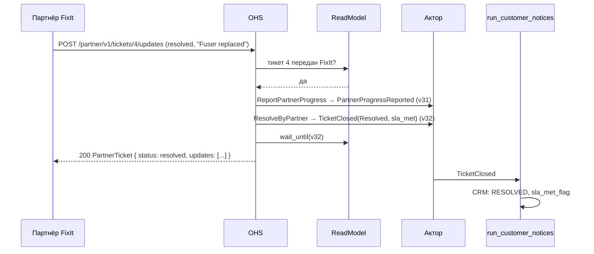

## 7. Полная схема команд и событий

### 7.1. Команды

| Команда (`command::Command`) | Кто отправляет | Команда агрегата | Событие | Отказы → HTTP |
|---|---|---|---|---|
| `RegisterTenant` | `POST /api/tenants`, seed | `TenantCommand::Register` с выданным id | `TenantRegistered` | `EmptyName` 422 |
| `RegisterUser` | `POST /api/users`, seed | `UserCommand::Register` с выданным id | `UserRegistered` | `EmptyName` 422 |
| `CreateTicket` | `POST /api/tickets` и seed — после `admit_ticket` | `TicketCommand::Create` с id, временем и уровнем клиента из CRM | `TicketCreated` | до команды: клиента нет в CRM 404, счёт не активен 409, CRM недоступна 503 / ответила непереводимо 502; в агрегате: `UnknownTenant` 404, `EmptyDescription` 422, `EmptyCategory` 422 |
| `AssignAgent` | `POST /api/tickets/{id}/assign` | `TicketCommand::AssignAgent` с агрегатом `User` и временем | `AgentAssigned` | `UnknownUser` 404, `NotFound` 404, `NotAnAgent` 422, `AlreadyAssigned` 409, `Closed` 409 |
| `CloseTicket` | `POST /api/tickets/{id}/close` (причина `Resolved`), сага (причина `Inactivity`) | `TicketCommand::Close` | `TicketClosed` | `NotFound` 404, `Closed` 409; для саги — `StillActive`, `Closed` (норма) |
| `ReopenTicket` | `POST /api/tickets/{id}/open` | `TicketCommand::Reopen` | `TicketReopened` | `NotFound` 404, `AlreadyOpen` 409 |
| `SendReminder` | сага | `TicketCommand::SendReminder { kind, at }` | `ReminderSent` | `ReminderNotDue`, `ReminderAlreadySent`, `Closed` (норма) |
| `ApplyDiscount` | `DiscountPolicy` | `TenantCommand::ApplyDiscount` с числом открытых из `OpenTickets` | `DiscountApplied` | `NotFound`, `DiscountUnchanged` (норма) |
| `RecordResourceCheck` | `run_resource_planning` | `TicketCommand::RecordResourceCheck { availability, at }` | `ResourcesChecked` | `ResourcesAlreadyChecked`, `Closed` (норма) |
| `HandToPartner` | `run_resource_planning` | `TicketCommand::HandToPartner { partner_id, at }` | `HandedToPartner` | `PartnerNotNeeded`, `AlreadyWithPartner`, `Closed` (норма) |
| `ReportPartnerProgress` | `POST /partner/v1/tickets/{id}/updates` (`in_progress`, а также комментарий к `resolved`) | `TicketCommand::ReportPartnerProgress { partner_id, comment, at }` | `PartnerProgressReported` | `NotWithPartner` 404, `EmptyComment` 422, `Closed` 409 |
| `ResolveByPartner` | `POST /partner/v1/tickets/{id}/updates` (`resolved`) | `TicketCommand::ResolveByPartner { partner_id, at }` | `TicketClosed` (`Resolved`) | `NotWithPartner` 404, `Closed` 409 |

### 7.2. События и их потребители

| Событие | Поля | `TicketLifecycleSaga` | `OpenTickets` (запись) | `ReadModel` (чтение) | `DiscountPolicy` | Интеграции |
|---|---|---|---|---|---|---|
| `TenantRegistered` | `tenant_id, tenant_name` | — | — | новый `TenantView`: 0%, 0 открытых | — | — |
| `UserRegistered` | `user_id, user_name, role` | — | — | новый `UserView` | — | — |
| `TicketCreated` | `ticket_id, category, description, tenant_id, tier, sla, at` | старт, три срока | открытых +1 | новый `TicketView` (Open, `tier`, `sla`); `by_tenant`; тенант: открытых +1 | `ApplyDiscount(tenant_id)` | планирование ресурсов; CRM: `Received` |
| `AgentAssigned` | `ticket_id, agent_id, previous_agent_id, at` | все сроки заново | — | агент, InProgress, активность, счётчик напоминаний 0; `active_by_agent`: от прежнего агента к новому | — | — |
| `ReminderSent` | `ticket_id, agent_id, kind, at` | — | — | `reminders_sent` +1 | — | — |
| `TicketClosed` | `ticket_id, tenant_id, agent_id, reason, sla_met, at` | конец, дедлайны удалены | открытых −1 | Closed, `closed_at`, `close_reason`, `sla_met`; убран из `active_by_agent`; в индекс `closed`; тенант: открытых −1 | `ApplyDiscount(tenant_id)` | CRM: `Closed` |
| `TicketReopened` | `ticket_id, tenant_id, category, sla, at` | старт заново | открытых +1 | Open, без агента и партнёра, новое `sla`, ресурсы и отчёты партнёра сброшены, `closed_at` и `close_reason` сброшены, активность, счётчик 0; убран из `closed` и `by_partner`; тенант: открытых +1 | `ApplyDiscount(tenant_id)` | планирование ресурсов; CRM: `Reopened` |
| `ResourcesChecked` | `ticket_id, availability, at` | — | — | `resources` | — | — |
| `HandedToPartner` | `ticket_id, partner_id, at` | — | — | `partner` с временем передачи; в `by_partner` | — | — |
| `PartnerProgressReported` | `ticket_id, partner_id, comment, at` | все сроки заново | — | отчёт в `partner_updates`, активность, счётчик напоминаний 0 | — | — |
| `DiscountApplied` | `tenant_id, previous_rate, discount_rate, open_tickets` | — | — | `discount_rate` тенанта | — (иначе политика реагировала бы на свой результат) | — |

Какие уведомления порождают события — в [разделе 5.2](#52-хореография). `agent_id` в
`ReminderSent` равен `None`, если агента нет: такое напоминание адресовано администраторам.

Каждое событие меняет запись в read-модели и её версию, поэтому все они видны клиентам
в `GET /api/changes`. `tenant_id` и `agent_id` в `TicketClosed`, `tenant_id` и `category`
в `TicketReopened` есть именно ради потребителей: политика — чистая функция, ей нужно узнать
всё из самого события. `sla` записано в события, а не пересчитывается: смена правил не
меняет обещаний, уже данных клиенту.

### 7.3. Пример: закрытие тикета, после которого пропадает скидка

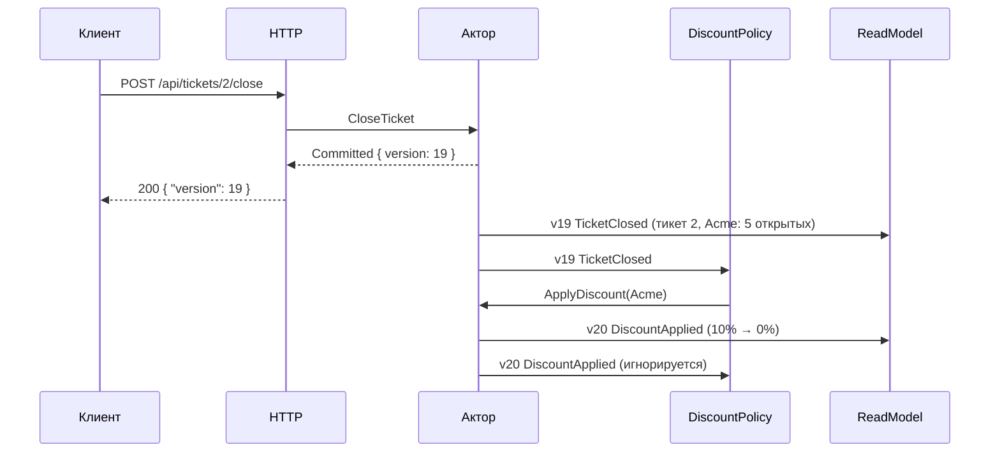

## 8. Взаимодействие клиента и сервера

### 8.1. HTTP API

Команды — `POST`, ответ `CommandAcceptedDto { version }`. Команда проверяется на командной
стороне сразу, поэтому ошибки клиент получает в ответе: `{"error": "..."}` с кодом
404 (нет объекта), 409 (противоречит состоянию), 422 (неверные данные), 503 (актор или CRM
не отвечает), 502 (CRM ответила так, что ответ нельзя понять).

| Метод и путь | Ответ |
|---|---|
| `POST /api/tickets/{id}/open` | `CommandAcceptedDto` |
| `POST /api/tickets/{id}/close` | `CommandAcceptedDto` |
| `POST /api/tickets/{id}/assign` с `{"agent_id": N}` | `CommandAcceptedDto` |
| `POST /api/tenants` с `{"tenant_name": "...", "tier": "Gold\|Silver\|Bronze"}` | `CommandAcceptedDto`; заодно заводит счёт в CRM демо, `tier` необязателен (Bronze) |
| `POST /api/users` с `{"user_name": "...", "role": "Customer\|Agent\|Admin"}` | `CommandAcceptedDto` |
| `POST /api/tickets` с `{"category": "...", "description": "...", "tenant_id": N}` | `CommandAcceptedDto` |
| `GET /api/tickets?status=Open\|InProgress\|Closed&tenant=N` | `[TicketDto]`, фильтры необязательны |
| `GET /api/tickets/{id}` | `TicketDto` или 404 |
| `GET /api/tickets/closed?days=N` | `[TicketDto]` — закрытые за N дней, по времени закрытия |
| `GET /api/agents/{id}/tickets` | `[TicketDto]` — незакрытые тикеты агента |
| `GET /api/tenants/{id}/tickets/unassigned` | `[TicketDto]` — открытые и никому не назначенные |
| `GET /api/tenants`, `GET /api/tenants/{id}` | `[TenantDto]`, `TenantDto` или 404 |
| `GET /api/users` | `[UserDto]` |
| `GET /api/users/{id}/notifications` | `[NotificationDto]` — входящие пользователя, от старых к новым |
| `GET /api/changes[?epoch=E&since=V]` | `ChangesDto` — long polling |
| `/partner/v1/...` | Open-Host Service для партнёров — [раздел 6.4](#64-open-host-service-для-партнёров) |

`TicketDto` кроме полей HW9 несёт `tier`, `sla_due_at`, `sla_met`, `resources`, `partner`
(имя из справочника партнёров), `handed_over_at` и `partner_updates`.

### 8.2. Long polling

Позиция клиента — `Cursor { epoch, version }`. `epoch` — идентификатор запуска сервера:
версии разных запусков несравнимы, а in-memory состояние после перезапуска другое.

| Запрос | Ответ сервера |
|---|---|
| без курсора | сразу всё состояние, `full: true` |
| курсор с чужой эпохой | сразу всё состояние, `full: true` — клиент выбрасывает своё |
| своя эпоха, есть изменения после `since` | сразу изменённые записи, `full: false` |
| своя эпоха, изменений нет | ждёт изменений до 25 с; по таймауту — пустой ответ с той же версией |

Ответ содержит каждую изменённую запись один раз в последнем состоянии — промежуточные
состояния не нужны. Уведомления не меняются, поэтому каждое приходит один раз. Следующий запрос — с `ChangesDto::cursor()`.

`since` может обгонять read-модель: клиент получает версию команды раньше, чем проекция
её применит. Тогда сервер просто ждёт — так клиент гарантированно видит собственные изменения.

### 8.3. Клиент

- **`Replica`** — копия read-модели сервера на клиенте. Полный ответ заменяет всё,
  дельта заменяет записи по одной. Уведомления всех получателей лежат здесь же, и
  `notifications_of` отбирает входящие пользователя по тем же правилам, что и сервер.
- **Цикл синхронизации** `TicketViewModel::sync_forever`: `poll_once` за `poll_once`;
  после обрыва связи — пауза 0,5 → 1 → 2 → … → 10 с, после успеха сбрасывается.
  Индикатор показывает `live · vN` или `offline · reconnecting…`.
- **Свои команды не меняют состояние.** Ответ команды — версия; клиент остаётся занятым
  (кнопки заблокированы), пока его поток изменений не дойдёт до неё. Результат своей
  команды клиент видит тем же путём, что и чужие изменения. Полный ответ (перезапуск
  сервера) снимает ожидание: версия из прошлого запуска уже не придёт.
- **Проверки на обеих сторонах.** Клиент не отправляет заведомо недопустимую команду
  (`TicketRules`), сервер всё равно проверяет её в агрегате.
- **Формы создания** тенанта, пользователя и тикета: поля живут в `CreationForms`, а запрос
  собирают функции модели (`new_tenant`, `new_user`, `new_ticket`) — они и решают, доступна ли
  кнопка. При успехе текст очищается, при отказе сохраняется вместе с сообщением об ошибке.
- **Панель уведомлений.** Выбор пользователя — это не вход в систему: от него зависит только то,
  чьи входящие показаны. Новый запрос к серверу не нужен, всё уже пришло через long polling.
- **Сроки на карточке тикета** — абсолютные даты с сервера. Клиент не считает обратный отсчёт от
  своих часов: при `--time-scale` они не совпадают с часами системы.
- **Панель запросов** вызывает GET-запросы read-модели и выполняет выбранный запрос заново,
  когда long polling приносит изменения.
- **Карточка тикета** показывает уровень клиента в CRM, срок SLA (у закрытого — уложились
  ли), ответ ERP, партнёра и его отчёты. Форма тенанта выбирает уровень CRM.
- **Портал партнёра** — отдельная пара `PartnerPortalService` и `PartnerViewModel`. Он знает
  только токен и `partner_api` и ходит в `/partner/v1` с заголовком `Authorization`, как
  приложение настоящего партнёра. Своей подписки у OHS нет, поэтому портал перечитывает список
  после своих действий и когда основной клиент получает новую версию через long polling.
  Отозванный токен (401) выводит из портала.

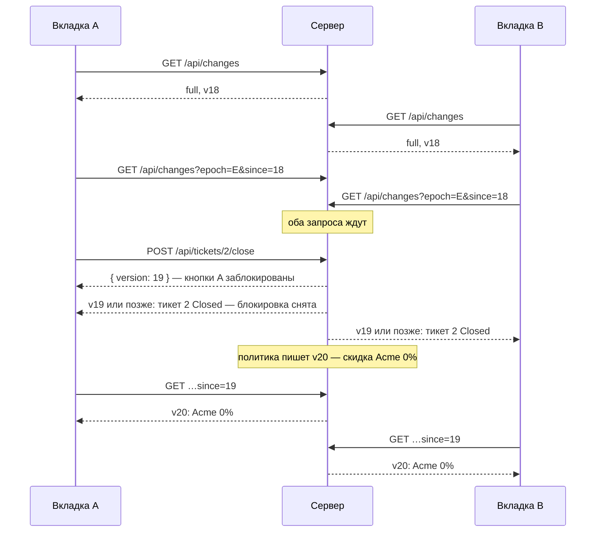

## 9. Гарантии и ограничения

- **Согласованность.** Командная сторона строго согласована: один писатель, проверки
  в агрегате. Read-модель, скидка и сага согласованы в конечном счёте: обновляются асинхронно,
  отставание видно по версии, дождаться результата команды можно по её версии.
- **Порядок.** Все события имеют единый порядок версий; проекция применяет их по порядку
  без пропусков, политики и сага реагируют в том же порядке.
- **Доставка событий.** Подписчики получают каждое событие ровно один раз в пределах процесса;
  проекция к тому же идемпотентна по версии.
- **Точность дедлайнов.** Дедлайн срабатывает на ближайшем тике, поэтому опаздывает не больше чем
  на тик (по умолчанию 1 с) плюс очередь других дедлайнов. Раньше срока команда не пройдёт:
  это проверяет агрегат. При `--time-scale` тик сокращается, чтобы опоздание было не больше минуты
  времени системы, но не короче 10 мс.
- **Доставка уведомлений и обращения к CRM и ERP — не более одного раза.** Отказ `Notifier`,
  `CustomerNotifier` или `Inventory` уходит в обработчик ошибок, повторов нет. Если ERP не
  ответила, тикет остаётся без проверки ресурсов; если CRM пропустила `NEW`, следующее
  сообщение о том же обращении она отвергнет по правилам переходов. `run_notifications` не хранит свою позицию: с постоянным журналом перезапуск
  прислал бы всё заново, поэтому там понадобились бы сохранённая позиция и идемпотентный получатель.
- **Нет авторизации сотрудников.** Long polling приносит уведомления всех получателей, и клиент
  отбирает нужные сам. В настоящей системе сервер фильтровал бы их по вошедшему пользователю.
  Партнёры аутентифицируются, но токены — константы демо, без выдачи, отзыва и срока действия.
- **Решение партнёра с комментарием — две команды.** Если закрытие отклонят, отчёт останется.
- **Справочники в коде.** Связь категорий тикетов с группами материалов ERP — в `ErpAdapter`,
  партнёры и их категории — в `ExternalSystems::demo`.
- **Нет постраничной выдачи и отметок о прочтении.** Журнал, входящие и полный ответ
  `/api/changes` растут вместе с историей.
- **Хранение в памяти.** Всё состояние живёт в одном процессе и пропадает при перезапуске;
  журнал актора хранит все события, чтобы на него можно было подписаться с любой версии.
  Для учебной системы это осознанный выбор: трейты хранилищ и проекции позволяют заменить
  реализации, не трогая остальной код. Сага восстановится из постоянного журнала сама: сроки
  считаются из времени в событиях, а просроченные за время простоя дедлайны сработают по порядку.
- **Один сервер.** Актор и read-модель — в одном процессе. Масштабирование потребовало бы
  внешнего журнала событий (реализация `EventSource`) и общего хранилища read-модели.
