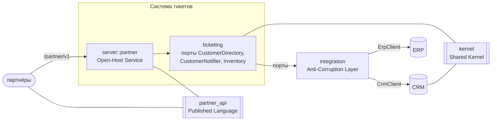

# HW10 — коммуникационные паттерны: ACL, Open-Host Service, Shared Kernel

Система тикетов из HW6–HW9 работает с внешним миром: проверяет клиента в CRM, спрашивает
ERP о ресурсах, передаёт тикеты партнёрам и сообщает клиенту о результате через CRM.
С CRM и ERP она говорит через Anti-Corruption Layer, партнёрам открывает Open-Host Service
с опубликованным языком, а правила статусов и SLA делит с CRM в Shared Kernel. Всё на Rust:
ядро и сервер на tokio + axum, клиент на Leptos (wasm).

Устройство системы — абстрактное ядро, обе стороны CQRS, сага, интеграции, полная схема
команд и событий, протоколы — описано в [ARCHITECTURE.md](ARCHITECTURE.md). Здесь — про
реализацию.

## Запуск

```sh
rustup target add wasm32-unknown-unknown   # один раз
cargo install trunk                         # один раз

cd client && trunk build && cd ..
cargo run -p server                         # http://127.0.0.1:3000, система пуста
cargo run -p server -- --seed               # с демо-данными
cargo run -p server -- --time-scale 8640    # часы идут быстрее: сутки за 10 секунд
cargo run -p server -- --port 8000          # другой порт; --port 0 — любой свободный
```

Разработка клиента: сервер запущен отдельно, в `client/` — `trunk serve`
(http://127.0.0.1:8080, запросы `/api/` проксируются на порт 3000). Если сервер на другом
порту: `trunk serve --proxy-backend http://127.0.0.1:8000/api/`.

Тесты: `cargo test --workspace`.

### Внешний мир демо

CRM и ERP — in-memory системы внутри сервера (`server/src/world.rs`), система тикетов видит их
только через адаптеры ACL.

| Что | Как устроено в демо |
|---|---|
| CRM | Счёт клиента заводится вместе с тенантом, уровень — из формы или запроса (`tier`, по умолчанию Bronze). SLA: Gold — 1 день, Silver — 3, Bronze — 5. |
| ERP | Склад сервисной службы. Для `Hardware` свободных запчастей нет, для `Network` есть. Остальные категории решаются без материалов, и ERP о них не спрашивают. |
| Партнёры | FixIt Hardware берёт `Hardware`, токен `fixit-demo-token`; NetCo берёт `Network`, токен `netco-demo-token`. |

### Что посмотреть: интеграции

1. Запустите `cargo run -p server -- --seed` и откройте http://127.0.0.1:3000.
2. Выберите тикет 4 «Printer on floor 3 is offline». На карточке: уровень CRM `Gold`, срок SLA —
   через сутки, ресурсы ERP `out of stock`, партнёр `FixIt Hardware`. Тикет 1 про VPN — `Network`:
   ресурсы `in stock`, партнёра нет.
3. В панели «Partner portal» войдите с токеном `fixit-demo-token`. Партнёр видит только тикет 4.
   Напишите комментарий и нажмите «Report progress»: отчёт появится и в панели партнёра, и на
   карточке тикета у сотрудников, а срок автозакрытия отодвинется.
4. Нажмите «Resolve». Тикет закроется у всех, на карточке появится «SLA met».
5. В панели «Create» заведите тенанта с уровнем Silver и тикет для него — срок SLA будет через 3 дня.

Тот же Open-Host Service без клиента:

```sh
curl -H 'Authorization: Bearer fixit-demo-token' http://127.0.0.1:3000/partner/v1/tickets
curl -X POST -H 'Authorization: Bearer fixit-demo-token' -H 'Content-Type: application/json' \
     -d '{"status":"in_progress","comment":"Technician is on the way"}' \
     http://127.0.0.1:3000/partner/v1/tickets/4/updates
curl -i http://127.0.0.1:3000/partner/v1/tickets          # 401: нет токена
curl -H 'Authorization: Bearer netco-demo-token' \
     http://127.0.0.1:3000/partner/v1/tickets/4           # 404: тикет чужой
```

Сбои внешних систем сервер пишет в stderr, например
`warning: resource planning: resources for ticket-5 are not checked: ERP is unavailable: ERP timeout`.

### Что посмотреть: дедлайны (из HW9)

При `--time-scale 8640` сутки длятся 10 секунд: напоминания приходят через 30 и 90 секунд,
автозакрытие — через 100. Домен и сага об ускорении не знают: для них проходят обычные 10 дней.

1. Запустите `cargo run -p server -- --time-scale 8640` и откройте http://127.0.0.1:3000.
2. В панели «Create» заведите тенанта, агента, администратора и два тикета. На карточке
   тикета виден срок автозакрытия — через 10 дней — и срок SLA.
3. В панели уведомлений выберите администратора: там «new ticket needs an agent».
4. Назначьте агента на второй тикет: сдвинутся сроки, у агента появится «assigned to you».
5. Через 30 секунд после создания первого тикета администратор получит «reminder: stale»,
   через 90 — «reminder: closing soon», через 100 тикет закроется сам с причиной «inactivity»,
   а SLA на карточке станет «missed».

### Что посмотреть: хореография и long polling (из HW9)

1. Запустите `cargo run -p server -- --seed` и откройте http://127.0.0.1:3000 в двух вкладках.
2. Закройте тикет Acme в одной вкладке: во второй почти сразу меняются статус тикета, число
   открытых тикетов и скидка Acme (10% → 0%).
3. Остановите сервер — индикатор станет `offline · reconnecting…`; запустите снова —
   клиент переподключится и получит новое состояние целиком.

## Структура

| Крейт | Что внутри | Главные файлы |
|---|---|---|
| `framework` | Абстрактное ядро без знания о тикетах: event sourcing, CQRS, саги с дедлайнами, in-memory хранилища | `event_sourcing/{lifecycle,repository}.rs`, `cqrs/{command_bus,event_source,projection,query,policy,runner}.rs`, `saga/*.rs` |
| `kernel` | **Shared Kernel** с CRM: время, статусы тикета и правила переходов, уровни клиентов и SLA | `status.rs`, `sla.rs`, `time.rs` |
| `ticketing` | Домен (агрегаты `Ticket`, `Tenant`, `User`) и слой приложения: сервис, сага, политики, **порты к CRM и ERP**, приём тикета, планирование ресурсов, сообщения клиенту | `domain/ticket/*.rs`, `application/{ports,intake,resource_planning,customer_notices,partners}.rs` |
| `external` | Чужие системы: CRM и ERP со своей моделью и клиентом, in-memory | `crm.rs`, `erp.rs` |
| `integration` | **Anti-Corruption Layer**: `CrmAdapter`, `ErpAdapter` | `crm.rs`, `erp.rs` |
| `partner_api` | **Published Language** Open-Host Service, версия 1 | `lib.rs` |
| `command` | Командная сторона: актор — единственный писатель, глобальные версии, цикл саги | `actor.rs`, `lifecycle.rs` |
| `query` | Запросная сторона: модели представления, запросы, read-модель с индексами | `views.rs`, `queries.rs`, `state.rs` |
| `api` | Внутренний HTTP-контракт: DTO и пути для нашего клиента | `lib.rs` |
| `server` | Сборка системы, внешний мир демо, HTTP: команды, запросы, long polling, **Open-Host Service** | `lib.rs`, `world.rs`, `partner.rs`, `commands.rs`, `seed.rs` |
| `client` | Веб-клиент по MVVM, включая **портал партнёра** | `model/{replica,ticket_api,partner_portal}.rs`, `view_model.rs`, `partner_view_model.rs`, `view.rs` |



## Адаптация задания

Задание написано не под эту систему, поэтому его понятия переложены на то, что в ней есть.

| В задании | В системе |
|---|---|
| Клиент компании | Тенант. В CRM за ним стоит счёт `ACC-000042` с уровнем обслуживания. |
| «Наличие ресурсов» в ERP | Запчасти на складе сервисной службы: категории `Hardware` и `Network` требуют группы материалов `MG-HW` и `MG-NET`. Партнёр нужен, когда свободных запчастей нет. |
| Классы `CRMAdapter`, `ERPAdapter` | Порты (трейты) в `ticketing::application::ports` и их реализации `CrmAdapter`, `ErpAdapter` в крейте `integration`. Домен не видит модели CRM и ERP. |
| `CRMClient`, `CRMResponse` | `external::crm::{CrmClient, CrmAccount, CrmCaseActivity}`: коды `GLD`/`SLV`/`BRZ` и `A`/`S`/`C`, номера счетов и обращений, миллисекунды. ERP — SAP-подобные поля `werks`, `matkl`, `labst`, `resb`. |
| `TicketController` с `GET /{id}` и `POST /{id}/update` | `GET /partner/v1/tickets[/{id}]`, `POST /partner/v1/tickets/{id}/updates` с `{"status": "in_progress" \| "resolved", "comment": ...}`. |
| `SLA` с `isOverdue()` от `LocalDateTime.now()` | `kernel::sla::Sla` с `is_overdue(at)`: время передаётся снаружи, поэтому SLA одинаково считают агрегат, read-модель и CRM, и работают тесты и `--time-scale`. |
| Валидация статусов в Shared Kernel | `kernel::status::TicketStatus::{can_become, transition_to}`. Агрегат `Ticket` проверяет по ним назначение, закрытие и повторное открытие, а CRM — историю обращений клиента. |

Отличия от текста задания — решения, принятые при обсуждении:

| В задании | В коде | Почему |
|---|---|---|
| Shared Kernel с CRM — и ACL к той же CRM | Протокол CRM чужой и переводится в ACL, а правила статусов и SLA согласованы и лежат в общем `kernel`, от которого зависит и CRM | Иначе одно противоречит другому: общая модель не нуждалась бы в переводе. Shared Kernel — договорённость о правилах, ACL — защита от чужого формата. |
| Уведомить клиента через CRM после завершения | Через CRM уходят принятие, закрытие и повторное открытие тикета | История обращения в CRM должна быть полной: иначе после повторного открытия CRM увидела бы «закрыто → закрыто», что запрещают правила Shared Kernel. Закрытие несёт отметку, уложились ли в SLA. |
| Передавать статус во внешние партнёрские API | Партнёр сам забирает тикеты через OHS, push нет | Не нужен ещё один фейковый внешний сервер, а смысл тот же: партнёр узнаёт о переданных ему тикетах. |
| `POST /update` с произвольным статусом | Партнёр сообщает только `in_progress` с комментарием или `resolved`; закрыть может лишь тот, кому передан тикет | Решение принимает агрегат по правилам Shared Kernel, а чужой тикет для партнёра не существует (404). |
| — | Опубликованный язык `partner_api` отделён от внутреннего `api` и версионирован (`/partner/v1`) | Внутренний API меняется вместе с нашим клиентом, контракт партнёров — только новой версией. |
| — | Партнёр узнаётся по токену `Authorization: Bearer` | Иначе нельзя показать, что партнёр видит только свои тикеты. Токены — демо-константы. |
| — | CRM и ERP — in-memory системы внутри сервера, а не HTTP-заглушки | Учебный пример: чужая модель и перевод видны и так, а сеть добавила бы только инфраструктуру. |
| — | Тенант при создании получает счёт в фейковой CRM | В жизни счёт в CRM уже был бы; в демо его заводит сервер, как менеджер CRM, — иначе пустую систему не пройти. |

## Пункты задания и где они в коде

| Пункт | Код | Тесты |
|---|---|---|
| 1. Создание тикета и проверка клиента в CRM | `ticketing/src/application/intake.rs` (`admit_ticket`), `server/src/commands.rs` | `active_customer_gets_ticket_with_tier_from_crm`, `unknown_or_inactive_customer_is_not_admitted`, `crm_failure_stops_intake`; `server/src/lib.rs`: `crm_decides_who_may_open_tickets` |
| 1. Проверка ресурсов в ERP | `ticketing/src/application/resource_planning.rs`, `RecordResourceCheck` → `ResourcesChecked` | `available_resources_are_recorded_and_ticket_stays_in_house`, `erp_failure_leaves_ticket_unchecked_and_loop_goes_on`, `resource_check_is_recorded_once`, `resource_check_is_not_activity` |
| 1. Передача партнёру | `run_resource_planning`, `PartnerRoster`, `HandToPartner` → `HandedToPartner` | `missing_resources_send_ticket_to_partner_of_its_category`, `without_partner_for_category_ticket_stays_in_house`, `partner_is_needed_only_when_resources_are_unavailable`, `ticket_is_handed_to_one_partner_only`; `ticket_without_parts_goes_to_partner_and_with_parts_stays` |
| 1. Уведомление клиента через CRM | `ticketing/src/application/customer_notices.rs` | `customer_learns_when_ticket_is_received_and_when_it_is_due`, `customer_learns_how_ticket_was_closed_and_whether_sla_was_met`, `internal_steps_are_not_told_to_customer`, `failed_notice_is_reported_and_others_go_on`; `customer_hears_about_ticket_through_crm` |
| 2. ACL: отдельные адаптеры, логика API внутри них | `integration/src/{crm,erp}.rs`, порты `ticketing/src/application/ports.rs` | `directory_finds_customer_or_reports_unknown`, `outage_is_unavailable_and_bad_data_is_rejected`, `notices_reach_crm_case_history`, `request_is_built_in_erp_terms`, `category_without_materials_does_not_ask_erp`, `adapter_works_with_in_memory_erp` |
| 2. Тесты преобразования данных | там же | CRM: `identifiers_are_translated_to_crm_numbers`, `account_becomes_customer_profile`, `service_level_codes_map_to_tiers`, `unknown_codes_are_rejected_not_guessed`, `suspended_and_closed_accounts_are_inactive`, `blank_email_means_no_email_and_blank_name_is_rejected`, `new_account_round_trips_to_the_same_profile`, `received_and_reopened_notices_carry_the_deadline_in_millis`, `closing_notice_names_how_and_whether_sla_was_met`, `huge_timestamp_does_not_overflow_millis`, `crm_refusal_is_reported_in_ticket_terms`; ERP: `categories_map_to_material_groups`, `free_stock_decides_availability`, `erp_faults_are_reported_in_ticket_terms` |
| 3. Open-Host Service: REST API для партнёров | `partner_api/src/lib.rs`, `server/src/partner.rs` | `paths_are_versioned`, `ticket_has_the_published_shape`, `update_comment_may_be_omitted`, `error_carries_machine_code`; `server/src/lib.rs`: `partner_sees_only_tickets_handed_to_it`, `partner_api_requires_a_known_token`, `partner_reports_progress_and_resolves_ticket`, `other_partner_cannot_report_on_foreign_ticket` |
| 3. Данные об обработке от партнёра | `ReportPartnerProgress`, `ResolveByPartner` в `ticketing/src/domain/ticket/mod.rs` | `partner_progress_is_activity_and_restarts_reminders`, `only_the_assigned_partner_reports_and_with_some_text`, `partner_resolution_closes_ticket_as_resolved`, `partner_cannot_resolve_foreign_or_closed_ticket`, `partner_path_runs_through_the_service` |
| 4. Shared Kernel: общие сущности и value objects | `kernel/src/{status,sla,time}.rs`; используют `ticketing` и `external::crm` | — |
| 4. Валидация статусов | `TicketStatus::{can_become, transition_to}`; `Ticket::ensure_can_become`; `InMemoryCrm::log_case_activity` | `allowed_transitions_are_exactly_the_lifecycle_ones`, `allowed_transition_returns_new_status`, `forbidden_transition_names_both_statuses`, `closed_ticket_cannot_be_closed_again_and_open_cannot_be_reopened`, `only_closed_ticket_is_not_open`; в CRM: `case_follows_shared_status_rules`, `case_starts_with_new_and_does_not_close_twice` |
| 4. Расчёт SLA | `CustomerTier::resolution_secs`, `Sla::{for_tier, due_at, is_overdue, remaining_secs}`; `TicketCreated.sla`, `TicketClosed.sla_met` | `higher_tier_gets_shorter_resolution_time`, `deadline_is_start_plus_resolution_time`, `sla_is_overdue_only_after_deadline`, `remaining_time_counts_down_to_zero`, `deadline_near_end_of_time_does_not_overflow`; в агрегате: `sla_comes_from_customer_tier`, `closing_reports_whether_sla_was_met`, `reopening_starts_new_sla_for_the_same_tier` |

Сверх задания:

| Что | Код | Тесты |
|---|---|---|
| Отчёт партнёра — активность: сдвигает напоминания и автозакрытие | `TicketLifecycleSaga::on_event`, `query/src/state.rs` | `partner_progress_moves_all_deadlines`, `resource_check_and_handover_do_not_move_deadlines`, `partner_progress_is_activity_and_moves_auto_close` |
| Read-your-writes в OHS: ответ на отчёт уже виден в `GET` | `server/src/partner.rs` (`post_update`) | `partner_reports_progress_and_resolves_ticket` |
| Портал партнёра в клиенте — работает только через OHS | `client/src/model/partner_portal.rs`, `client/src/partner_view_model.rs` | `tickets_are_asked_with_partner_token`, `update_posts_published_request`, `sign_in_shows_partner_tickets_and_selects_first`, `refresh_keeps_selection_and_signs_out_when_token_is_revoked` и др. |
| SLA, ресурсы и партнёр в read-модели и на карточке тикета | `query/src/{views,state}.rs`, `client/src/view.rs` | `partner_sees_only_tickets_handed_to_it` (read-модель), `partner_updates_and_sla_outcome_are_kept_after_closing`, `reopened_ticket_leaves_partner_and_starts_over` |

Из HW9 остались оркестратор с дедлайнами, хореография, `--time-scale`; из HW8 — командная сторона
как актор, query side и long polling.

## Тесты

| Крейт | Тестов | Что проверяют |
|---|---|---|
| `kernel` | 13 | переходы статусов, SLA и уровни, время |
| `external` | 7 | поведение фейковых CRM и ERP, проверка истории обращений по Shared Kernel |
| `integration` | 20 | перевод моделей CRM и ERP в обе стороны, ошибки внешних систем |
| `partner_api` | 4 | форма опубликованного языка в JSON |
| `framework` | 37 | `Lifecycle`, репозиторий и снапшоты, in-memory хранилище, циклы CQRS, очередь дедлайнов, `SagaManager` |
| `ticketing` | 137 | агрегаты, сервис приложения, сага, политики, часы, приём тикета, планирование ресурсов, сообщения клиенту |
| `command` | 15 | версии, подписка, отказы, цикл саги на остановленном времени tokio |
| `query` | 33 + 6 | проекция и запросы; интеграционные — весь конвейер актор → сага и политики → проекция |
| `server` | 29 + 7 | HTTP API, long polling, сроки в настоящем времени, интеграции и Open-Host Service; разбор аргументов |
| `api` | 1 | текст уведомлений |
| `client` | 61 | правила команд, формы, `Replica`, `TicketApiService` и портал партнёра на заглушке HTTP, обе ViewModel |

Разметку клиента тесты в репозитории не покрывают: её проверял разовый прогон сценария
«Что посмотреть: интеграции» в headless Chrome, сценарий в репозиторий не входит.

## Ограничения

- **Обращения к CRM и ERP не повторяются.** Если ERP не ответила, тикет остаётся без проверки
  ресурсов, и решать его придётся своими силами. Если CRM пропустила сообщение о принятии,
  следующее — о закрытии — она отвергнет по правилам переходов. Нужны повторы с паузой
  и сохранённая позиция циклов.
- **Отчёт с решением — две команды.** `resolved` с комментарием сначала записывает отчёт,
  потом закрывает тикет. Если закрытие отклонят, отчёт останется.
- **Связь категорий с материалами зашита в `ErpAdapter`,** а категория — свободный текст.
  В настоящей системе это был бы справочник.
- **Токены партнёров — константы демо.** Нет выдачи, отзыва и срока действия.
