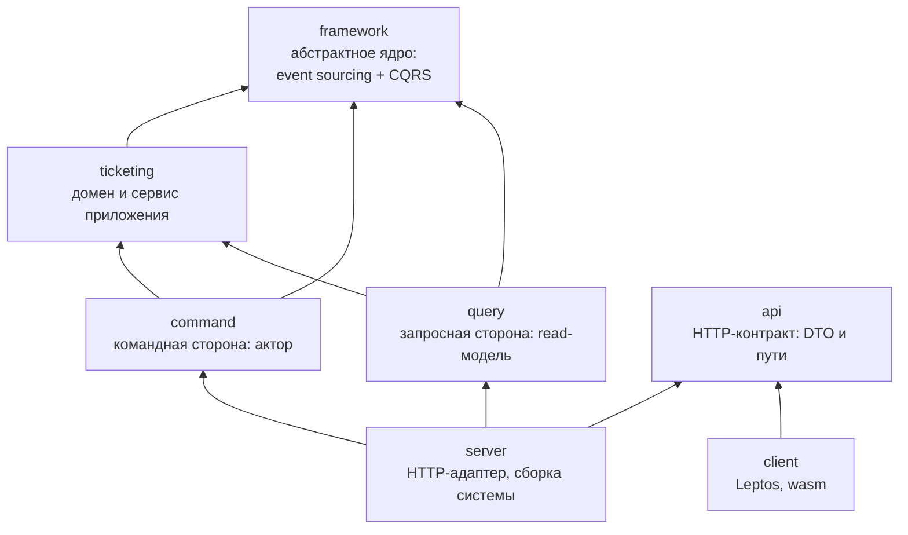
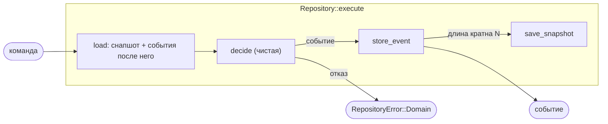
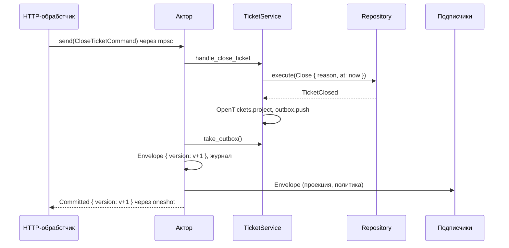
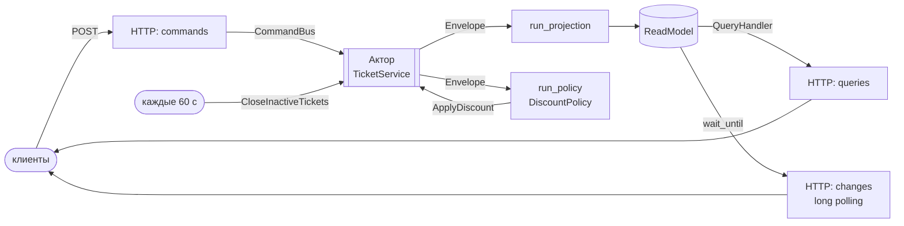
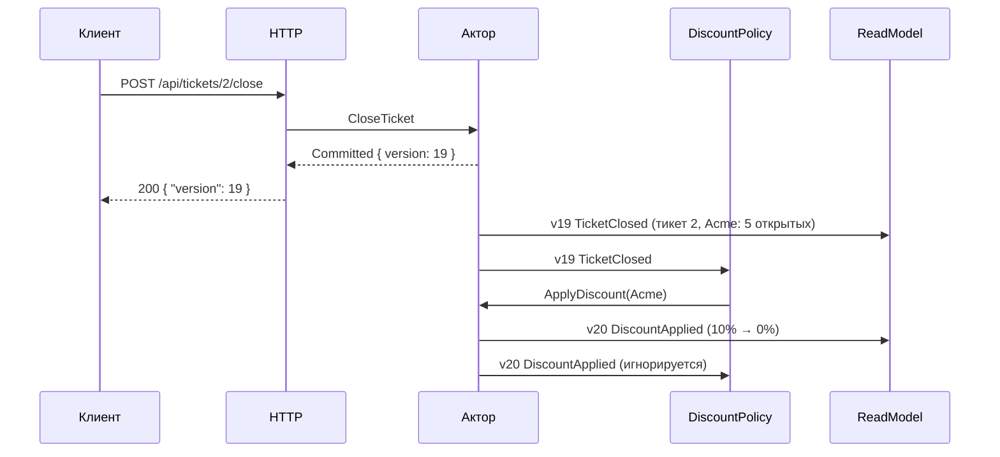
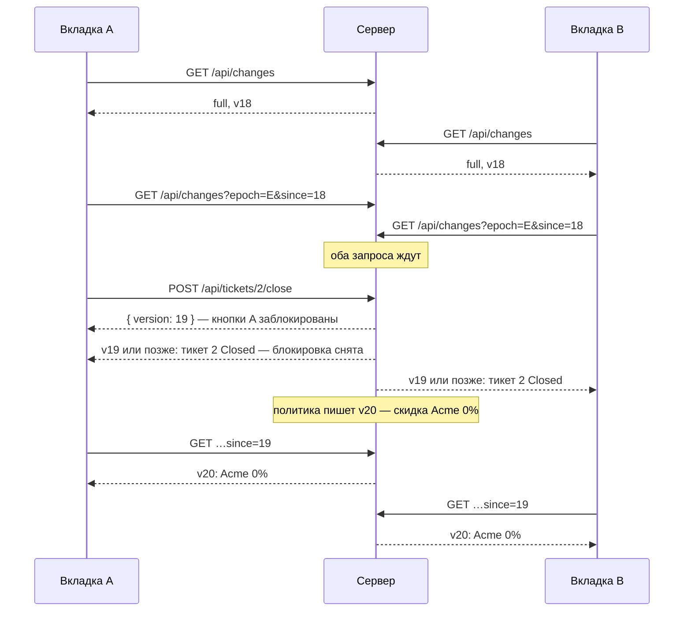

# Архитектура HW8

Система тикетов, разделённая по CQRS: команды меняют состояние через агрегаты на event
sourcing, запросы читают отдельную read-модель, которую строит поток событий. Клиенты
узнают об изменениях через long polling.

Документ описывает устройство: абстрактное ядро, обе стороны CQRS, полную схему команд
и событий и протокол между клиентом и сервером. Как запустить и где что лежит — в
[README.md](README.md).

- [1. Крейты и зависимости](#1-крейты-и-зависимости)
- [2. Абстрактное ядро `framework`](#2-абстрактное-ядро-framework)
- [3. Командная сторона](#3-командная-сторона)
- [4. Запросная сторона](#4-запросная-сторона)
- [5. Фоновые процессы](#5-фоновые-процессы)
- [6. Полная схема команд и событий](#6-полная-схема-команд-и-событий)
- [7. Взаимодействие клиента и сервера](#7-взаимодействие-клиента-и-сервера)
- [8. Гарантии и ограничения](#8-гарантии-и-ограничения)

## 1. Крейты и зависимости

- `framework` не знает о тикетах и не зависит ни от чего (tokio — только в тестах).
- `command` и `query` не зависят друг от друга: общий у них только тип события
  `ticketing::domain::DomainEvent` и конверт `framework::cqrs::envelope::Envelope`.
- Клиент знает только контракт `api` — ни домена, ни ядра.

## 2. Абстрактное ядро `framework`

Три модуля: `event_sourcing` — как агрегат принимает решения и восстанавливается из
событий, `cqrs` — как разделены запись и чтение и как их связывает поток событий,
`in_memory` — реализации хранилищ event sourcing. CQRS не требует event sourcing,
поэтому это отдельные модули; в проекте они встречаются в `TicketService`.

### 2.1. `event_sourcing`

Агрегат описывается двумя чистыми функциями без ввода-вывода:

| Трейт | Что задаёт |
|---|---|
| `Aggregate` | Словарь агрегата: типы `Command` и `Event`. |
| `CommandHandler` | `decide(&self, &Command) -> Result<Event, Error>` — решение: событие или отказ. Состояние не меняет. Всё нужное для решения (время, идентификаторы, данные других агрегатов) приходит в самой команде. |
| `EventHandler` | `apply_event(self, &Event) -> Self` — следующее состояние. Событие — уже свершившийся факт, отклонить его нельзя; невозможное событие означает испорченный стрим (паника). |
| `EventSourced` | Реализуется автоматически: `recover(stream)` — свёртка событий в состояние. |
| `Lifecycle` | Частый случай — агрегат, которого до первого события нет. Домен описывает `decide_new` (агрегата ещё нет), `decide`, `created` (первое событие) и `evolve`; каркас сам реализует три трейта выше для `Option<T>`, где `None` — пустой стрим. |

Хранение и связка:

| Тип | Что делает |
|---|---|
| `StreamId`, `EventPos` | Стрим — свой у каждого экземпляра агрегата. Позиция — граница *после* события: `EventPos(n)` — состояние после первых `n` событий, поэтому снапшот на позиции `n` и чтение стрима с `n` стыкуются без ±1. |
| `EventStore<E>` | Append-only стримы: `event_stream_from_pos`, `store_event`. Методы асинхронные, future — `Send`. |
| `SnapshotStore<A>` | Снапшоты: `save_snapshot(id, pos, state)`, `load_latest_snapshot`. Снапшот только ускоряет восстановление. |
| `Repository<A, ES, SS>` | `load` — последний снапшот плюс события после него; `execute` — load → decide → store → снапшот, если длина стрима кратна `snapshot_every`. Ошибки — `RepositoryError::{Domain, Storage}`. |

### 2.2. `cqrs`

| Тип / трейт | Роль |
|---|---|
| `Version` | Глобальная версия — номер события в общем порядке записи всех стримов. Как и `EventPos`, граница после события: `Version(0)` — ничего нет, первое событие — `Version(1)`. |
| `Envelope<E>` | Событие с его глобальной версией. |
| `Committed<E>` | Результат команды: версия после неё и записанные события. Версия — consistency token: read-модель, дошедшая до неё, видит результат команды. |
| `CommandBus<C>` | Входная точка записи: `send(command) -> Committed`. В отличие от `CommandHandler` агрегата, работает на уровне приложения: находит агрегат, подставляет время, упорядочивает команды. |
| `EventSource<E>`, `Subscription<E>` | Поток событий для читающей стороны: `subscribe(after)` отдаёт сначала уже записанные события с версией больше `after`, затем новые — без пропусков и повторов. |
| `Projection<E>` | Read-модель из потока: `project(&Envelope)` и `version()` — до какой версии догнала поток. Методы принимают `&self`: модель одновременно обновляют и читают. |
| `Query`, `QueryHandler<Q>` | Запрос — структура с параметрами и типом ответа `Output`; обработчик отвечает по read-модели и ничего не меняет. Симметрично командам. |
| `Policy<E>` | Process manager: чистая функция «событие → команды». Решает агрегат, поэтому отклонённая команда политики — нормальный исход. |

Фоновые циклы `cqrs::runner` написаны только на трейтах:

- `run_projection(source, projection)` — подписывается с `projection.version()` и
  применяет события. Ошибка проекции останавливает цикл: продолжать с дырой в модели нельзя.
- `run_policy(source, after, policy, bus, on_error)` — на каждое событие отправляет
  предложенные политикой команды по одной и по порядку; отказы уходят в `on_error`.

### 2.3. `in_memory`

`InMemoryEventStore` (вектор событий на стрим) и `InMemorySnapshotStore` (только последний
снапшот стрима). Методы асинхронные лишь потому, что так требуют трейты: внутри нет `await`.

### 2.4. Кто что реализует

| Абстракция | Реализация |
|---|---|
| `Lifecycle` | `Ticket`, `Tenant`, `User` (`ticketing::domain`) |
| `Repository` над `in_memory` | три репозитория в `TicketService` (снапшот каждые 2 события) |
| `CommandBus<C: Into<Command>>`, `EventSource<DomainEvent>` | `command::CommandActorHandle` |
| `Subscription<DomainEvent>` | `command::EventSubscription` (обёртка над каналом tokio — правило сирот не даёт реализовать трейт для чужого типа напрямую) |
| `Projection<DomainEvent>`, `QueryHandler<…>` для 9 запросов | `query::ReadModel` |
| `Policy<DomainEvent>` | `ticketing::application::discount_policy::DiscountPolicy` |

## 3. Командная сторона

### 3.1. `TicketService`

Сервис приложения (`ticketing::application`). Принимает внешние команды (`CreateTicketCommand`,
`CloseTicketCommand`, …), достраивает их до команд агрегатов — выдаёт идентификаторы,
берёт время из `Clock`, подставляет данные других агрегатов — и выполняет через репозитории.

- **`OpenTickets`** — собственная синхронная проекция командной стороны: число открытых
  тикетов тенанта и кандидаты на закрытие по неактивности. Она согласована с записью
  (обновляется в той же операции), поэтому скидку считают по ней, а не по read-модели,
  которая может отставать.
- **Outbox.** Каждое записанное событие сразу попадает в outbox, `take_outbox()` их
  забирает. События не теряются, даже если команда записала часть событий и вернула ошибку.

### 3.2. Актор (`command`)

`command::spawn(service)` запускает задачу tokio, которая единолично владеет
`TicketService`, и возвращает `CommandActorHandle`.

- **Один писатель.** Команды из очереди (ёмкость 64) выполняются строго по одной:
  между проверкой и записью ничего не вклинивается, у событий однозначный порядок,
  блокировок нет.
- **Журнал и версии.** После каждой команды актор забирает outbox, присваивает событиям
  следующие глобальные версии, дописывает их в журнал (общий поток всех стримов)
  и рассылает подписчикам. Отклонённая команда версию не занимает.
- **Подписка** с любой версии: история из журнала, затем новые события. Проекция и политика
  могут стартовать в любой момент — даже после seed.

## 4. Запросная сторона

`query::ReadModel` — клонируемая оболочка над состоянием в `RwLock` и `watch` с версией.

### 4.1. Модели представления

| View | Поля |
|---|---|
| `TicketView` | `ticket_id, category, description, status, assigned_agent, tenant_id, created_at, closed_at, version` |
| `TenantView` | `tenant_id, tenant_name, discount_rate, open_tickets, version` |
| `UserView` | `user_id, user_name, role, version` |
| `Changes` | `version` модели и изменённые записи каждого вида |

`version` записи — версия её последнего изменения. У закрытого тикета остаётся агент,
который им занимался.

### 4.2. Индексы под запросы

| Индекс | Запрос |
|---|---|
| `active_by_agent: UserId → {TicketId}` — незакрытые тикеты агента | `ActiveTicketsOfAgent` |
| `by_tenant: TenantId → {TicketId}` | `ListTickets { tenant_id }`, `UnassignedTicketsOfTenant` |
| `closed: {(closed_at, TicketId)}` — упорядочен по времени | `TicketsClosedSince(t)` — диапазон `t..` |
| `changed: {(Version, запись)}` — каждая запись один раз, под последней версией | `ChangesSince(v)` — диапазон `v+1..` |

Запросы: `GetTicket`, `ListTickets { status, tenant_id }`, `ActiveTicketsOfAgent`,
`UnassignedTicketsOfTenant`, `TicketsClosedSince`, `GetTenant`, `ListTenants`, `ListUsers`,
`ChangesSince`. Read-модель не знает текущего времени: «за последние N дней» превращает
в момент `since` сервер.

### 4.3. Применение событий

- Событие с версией не выше текущей пропускается — повторная доставка безопасна.
- Пропуск версии — ошибка `Gap`, ссылка на неизвестную запись — `UnknownTicket` /
  `UnknownTenant`. Каждый обработчик сначала находит все нужные записи и только потом
  меняет их, так что ошибка не оставляет модель наполовину обновлённой.
- Блокировка берётся только на время синхронного обновления или чтения и никогда не
  держится через `await`. Ждущих (`wait_until(version)`) модель будит, только когда
  изменения уже видны читателям.

## 5. Фоновые процессы

`server::app` запускает рядом с актором три задачи tokio:

| Задача | Что делает |
|---|---|
| `run_projection(актор, ReadModel)` | Держит read-модель в актуальном состоянии. |
| `run_policy(актор, v0, DiscountPolicy, актор)` | На события, меняющие число открытых тикетов, отправляет `ApplyDiscount`. `DiscountUnchanged` — норма, остальные отказы пишутся в stderr. |
| `command::repeat(актор, 60 с, CloseInactiveTickets)` | Время как источник команд: закрывает тикеты без активности 7 дней. |

## 6. Полная схема команд и событий

### 6.1. Команды

| Команда (`command::Command`) | Кто отправляет | Команда агрегата | Событие | Отказы → HTTP |
|---|---|---|---|---|
| `RegisterTenant` | seed | `TenantCommand::Register` с выданным id | `TenantRegistered` | `EmptyName` 422 |
| `RegisterUser` | seed | `UserCommand::Register` с выданным id | `UserRegistered` | `EmptyName` 422 |
| `CreateTicket` | seed | `TicketCommand::Create` с id и временем | `TicketCreated` | `UnknownTenant` 404, `EmptyDescription` 422 |
| `AssignAgent` | `POST /api/tickets/{id}/assign` | `TicketCommand::AssignAgent` с агрегатом `User` и временем | `AgentAssigned` | `UnknownUser` 404, `NotFound` 404, `NotAnAgent` 422, `AlreadyAssigned` 409, `Closed` 409 |
| `CloseTicket` | `POST /api/tickets/{id}/close` (причина `Resolved`) | `TicketCommand::Close` | `TicketClosed` | `NotFound` 404, `Closed` 409 |
| `ReopenTicket` | `POST /api/tickets/{id}/open` | `TicketCommand::Reopen` | `TicketReopened` | `NotFound` 404, `AlreadyOpen` 409 |
| `ApplyDiscount` | `DiscountPolicy` | `TenantCommand::ApplyDiscount` с числом открытых из `OpenTickets` | `DiscountApplied` | `NotFound`, `DiscountUnchanged` (норма) |
| `CloseInactiveTickets` | расписание | `TicketCommand::Close { Inactivity }` для каждого тикета из `OpenTickets::inactive_at` | `TicketClosed` × N | — |

Создание тикетов и регистрация доступны только через seed: HTTP-эндпоинтов для них
задание не требует. Закрыть по неактивности вручную нельзя, пока таймаут не истёк
(`StillActive`), — это проверяет агрегат.

### 6.2. События и их потребители

| Событие | Поля | `OpenTickets` (запись) | `ReadModel` (чтение) | `DiscountPolicy` |
|---|---|---|---|---|
| `TenantRegistered` | `tenant_id, tenant_name` | — | новый `TenantView`: 0%, 0 открытых | — |
| `UserRegistered` | `user_id, user_name, role` | — | новый `UserView` | — |
| `TicketCreated` | `ticket_id, category, description, tenant_id, at` | тикет открыт, активность = `at` | новый `TicketView` (Open); `by_tenant`; тенант: открытых +1 | `ApplyDiscount(tenant_id)` |
| `AgentAssigned` | `ticket_id, agent_id, previous_agent_id, at` | активность = `at` | агент, InProgress; `active_by_agent`: от прежнего агента к новому | — |
| `TicketClosed` | `ticket_id, tenant_id, reason, at` | тикет убран | Closed, `closed_at`; убран из `active_by_agent`; в индекс `closed`; тенант: открытых −1 | `ApplyDiscount(tenant_id)` |
| `TicketReopened` | `ticket_id, tenant_id, at` | снова открыт, активность = `at` | Open, без агента, `closed_at` сброшен; убран из `closed`; тенант: открытых +1 | `ApplyDiscount(tenant_id)` |
| `DiscountApplied` | `tenant_id, previous_rate, discount_rate, open_tickets` | — | `discount_rate` тенанта | — (иначе политика реагировала бы на свой результат) |

Каждое событие меняет запись в read-модели и её версию, поэтому все они видны клиентам
в `GET /api/changes`. `tenant_id` в `TicketClosed` и `TicketReopened` есть именно ради
потребителей: политика — чистая функция, тенанта ей нужно знать из самого события.

### 6.3. Пример: закрытие тикета, после которого пропадает скидка

## 7. Взаимодействие клиента и сервера

### 7.1. HTTP API

Команды — `POST`, ответ `CommandAcceptedDto { version }`. Команда проверяется на командной
стороне сразу, поэтому ошибки клиент получает в ответе: `{"error": "..."}` с кодом
404 (нет объекта), 409 (противоречит состоянию), 422 (неверные данные), 503 (актор не работает).

| Метод и путь | Ответ |
|---|---|
| `POST /api/tickets/{id}/open` | `CommandAcceptedDto` |
| `POST /api/tickets/{id}/close` | `CommandAcceptedDto` |
| `POST /api/tickets/{id}/assign` с `{"agent_id": N}` | `CommandAcceptedDto` |
| `GET /api/tickets?status=Open\|InProgress\|Closed&tenant=N` | `[TicketDto]`, фильтры необязательны |
| `GET /api/tickets/{id}` | `TicketDto` или 404 |
| `GET /api/tickets/closed?days=N` | `[TicketDto]` — закрытые за N дней, по времени закрытия |
| `GET /api/agents/{id}/tickets` | `[TicketDto]` — незакрытые тикеты агента |
| `GET /api/tenants/{id}/tickets/unassigned` | `[TicketDto]` — открытые и никому не назначенные |
| `GET /api/tenants`, `GET /api/tenants/{id}` | `[TenantDto]`, `TenantDto` или 404 |
| `GET /api/users` | `[UserDto]` |
| `GET /api/changes[?epoch=E&since=V]` | `ChangesDto` — long polling |

### 7.2. Long polling

Позиция клиента — `Cursor { epoch, version }`. `epoch` — идентификатор запуска сервера:
версии разных запусков несравнимы, а in-memory состояние после перезапуска другое.

| Запрос | Ответ сервера |
|---|---|
| без курсора | сразу всё состояние, `full: true` |
| курсор с чужой эпохой | сразу всё состояние, `full: true` — клиент выбрасывает своё |
| своя эпоха, есть изменения после `since` | сразу изменённые записи, `full: false` |
| своя эпоха, изменений нет | ждёт изменений до 25 с; по таймауту — пустой ответ с той же версией |

Ответ содержит каждую изменённую запись один раз в последнем состоянии — промежуточные
состояния не нужны. Следующий запрос — с `ChangesDto::cursor()`.

`since` может обгонять read-модель: клиент получает версию команды раньше, чем проекция
её применит. Тогда сервер просто ждёт — так клиент гарантированно видит собственные изменения.

### 7.3. Клиент

- **`Replica`** — копия read-модели сервера на клиенте. Полный ответ заменяет всё,
  дельта заменяет записи по одной.
- **Цикл синхронизации** `TicketViewModel::sync_forever`: `poll_once` за `poll_once`;
  после обрыва связи — пауза 0,5 → 1 → 2 → … → 10 с, после успеха сбрасывается.
  Индикатор показывает `live · vN` или `offline · reconnecting…`.
- **Свои команды не меняют состояние.** Ответ команды — версия; клиент остаётся занятым
  (кнопки заблокированы), пока его поток изменений не дойдёт до неё. Результат своей
  команды клиент видит тем же путём, что и чужие изменения. Полный ответ (перезапуск
  сервера) снимает ожидание: версия из прошлого запуска уже не придёт.
- **Проверки на обеих сторонах.** Клиент не отправляет заведомо недопустимую команду
  (`TicketRules`), сервер всё равно проверяет её в агрегате.
- **Панель запросов** вызывает GET-запросы read-модели и выполняет выбранный запрос заново,
  когда long polling приносит изменения.

## 8. Гарантии и ограничения

- **Согласованность.** Командная сторона строго согласована: один писатель, проверки
  в агрегате. Read-модель и скидка согласованы в конечном счёте: обновляются асинхронно,
  отставание видно по версии, дождаться результата команды можно по её версии.
- **Порядок.** Все события имеют единый порядок версий; проекция применяет их по порядку
  без пропусков, политика реагирует в том же порядке.
- **Доставка.** Подписчики получают каждое событие ровно один раз в пределах процесса;
  проекция к тому же идемпотентна по версии.
- **Хранение в памяти.** Всё состояние живёт в одном процессе и пропадает при перезапуске;
  журнал актора хранит все события, чтобы на него можно было подписаться с любой версии.
  Для учебной системы это осознанный выбор: трейты хранилищ и проекции позволяют заменить
  реализации, не трогая остальной код.
- **Один сервер.** Актор и read-модель — в одном процессе. Масштабирование потребовало бы
  внешнего журнала событий (реализация `EventSource`) и общего хранилища read-модели.
